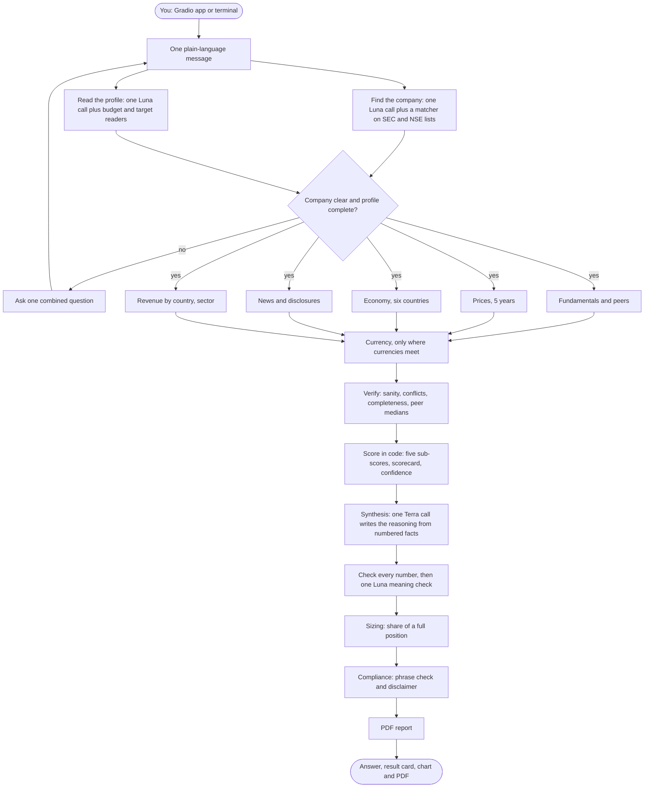

# AI Investment Suitability Agent

Ask about a company listed in India or the US, in plain words, with your budget and how
you invest, and the agent tells you whether the stock is a sensible fit for you and how
much of your money would make sense to put into it. Every number in its answer is traced
back to the filing, price feed or news article it came from, and a full PDF report comes
with each answer.

> "Should I invest in Microsoft? I have 5 lakhs, medium risk, 10 years, goal growth"
>
> **Verdict: Favourable, confidence high.** About ₹47,871 (about $497), less than the
> price of one share ($526), so a platform that sells part of a share is needed. A full
> position for this profile is ₹75,000. Business quality is the foundation: ROIC averaged
> 29.0% over 3 years, operating margin averaged 45.7% (up from 41.8%), and free cash
> flow was positive in 6 of 6 years. Valuation is the restraint: P/E 29.2 against a peer median of 24.4.
>
> (A real answer from 7 October 2026, shortened. Each run also gives the full reasoning,
> key risks, what would change the view, and a PDF.)

This is a personal project built to learn how to make an LLM agent that is honest about
what it knows. It is not investment advice. See [Disclaimer](#disclaimer).

<p align="center">
  
</p>

---

## What it does

- **Understands a plain question.** One text box, no form. The company, budget ("2 lakhs",
  "$5,000"), risk tolerance, horizon, goal and even a return target ("10% in 2 years") can
  all be in one message. If something is unclear (which Reliance? which listing of HDFC
  Bank?) it asks one question and carries the answers forward.
- **Gathers the evidence from five sources at once.** Six years of financials (SEC EDGAR
  for US companies, Trendlyne for Indian ones), five years of prices against the Nifty 50
  or S&P 500, the economy of the countries the company sells in, the last month of news
  and official disclosures, and the company's revenue by country and its sector.
- **Checks the figures before using them.** Sanity checks, conflicts between sources,
  how complete the data is, and the company's price multiples against similar companies.
- **Scores in plain code, not with the model.** Five sub-scores (business quality,
  valuation, economic fit, news, and a projection of next year's results) are combined
  with fixed weights into a verdict and a confidence level.
- **Uses the model only to explain.** One call writes the reasoning from numbered facts.
  Every number in it is then checked against the facts it cites, and a second, small model
  call checks each number is used with the right meaning. A sentence that fails is removed.
- **Suggests an amount that fits you.** A share of a "full position" (your concentration
  limit), set by the verdict, the score, the confidence and how much the stock swings,
  rounded to whole shares and converted between rupees and dollars where needed.
- **Writes a full PDF report.** A cover, 13 sections, the scorecard explained step by
  step, charts, every source listed, and a glossary of the terms used.
- **Keeps a record.** Every analysis goes into a decision log, so its verdict can be scored
  against what the stock actually did 12 months later.

## How it works



The agent is a [LangGraph](https://github.com/langchain-ai/langgraph) graph. Each data
source sits behind its own MCP server (entity, market data, filings, macro, news, FX), so
the graph's steps call tools rather than APIs directly. The five retrieval agents run at
the same time. Only three steps use a model, all OpenAI:

| Step | Model | What it does |
|---|---|---|
| Entity and profile | Luna (small) | Pull the company and the profile out of the message |
| News labelling | Luna, low effort | Label each article: relevant, fact or opinion, sentiment, importance |
| Synthesis | Terra (larger) | Write the reasoning from numbered facts; may move the verdict one step with a cited reason |
| Meaning check | Luna, low effort | Check each number in the reasoning is used with the right meaning |

Everything else, including the verdict, the confidence and the amount, is plain Python
that can be read and tested. The full diagram, with every source and rule, is in
[docs/architecture.md](docs/architecture.md).

### The scorecard

| Sub-score | Weight | What it measures |
|---|---|---|
| Business quality | 50% | Growth over the usual years, return on capital, margin trend, balance sheet, free cash flow |
| Valuation | 20% | P/E and EV/EBITDA against the median of similar companies |
| Economic fit | 15% | The economies the company sells in, against how sensitive its sector is to rates, inflation and growth |
| News | 5% | Net sentiment of the last month, weighted by importance |
| Forecast | 10% | A projected fair value a year out against today's price |

Each runs from -2 to +2. The weighted score is **Favourable at +0.75 or above** and
**Unfavourable at -0.5 or below**; anything between is Neutral. A few rules sit on top:

- **Missing data is never guessed.** A missing sub-score's weight is shared among the
  others, and the gap is listed.
- **Weaker comparisons count for less.** A valuation built on a weak comparison (peers
  from the wider sector, only 3 or 4 peers, or only P/B when most peers make losses) is
  marked low reliability, counts at half weight, and lowers confidence one step.
- **Price-driven scores slide.** Valuation and forecast move smoothly between their bands,
  so a price move of a percent or two cannot flip a whole point.
- **Confidence has to be earned.** It is high only when at least 4 of the 5 sub-scores
  exist and agree.
- **Hard overrides.** A serious filing (bankruptcy or a restatement), news that threatens
  the business itself, or a suitability rule for your profile caps the verdict at
  Neutral. The suitability rules cover a horizon under 3 years, a goal of protecting
  capital with a very volatile or heavily indebted stock, an income goal with no dividend,
  and needing the money soon with a thinly traded stock.

## How far to trust it

The scorecard was tested in two ways. The details are in [docs/findings.md](docs/findings.md).

- **A replay of the past.** 195 verdicts on the 50 largest US companies at the end of March
  2022, 2023, 2024 and 2025, using only the SEC figures that had been filed by each date,
  then scored against the S&P 500 over the next 12 months. Stocks with low scores trailed
  the market clearly (everything below -0.25: about -11% on average). Favourable verdicts
  did only about as well as the market, and no better than Neutral ones.
- **A spread check today.** 24 very different companies, Indian and US, through the live
  agent with one profile: 9 Favourable, 10 Neutral, 5 Unfavourable, each for a reason that
  can be read off its sub-scores.

So **the agent is better at spotting weak stocks than at picking winners**. The answer and
the PDF say so plainly, and the verdict is presented as a summary of the evidence, not a
prediction of the share price.

## Setup

You need Python 3.12 and [uv](https://docs.astral.sh/uv/). It runs on Windows, macOS
and Linux.

```bash
git clone https://github.com/Aakash289/AI-Investment-Advisor-System.git
cd AI-Investment-Advisor-System
uv sync
cp .env.example .env        # Windows PowerShell: Copy-Item .env.example .env
```

Then fill in `.env`. Only the OpenAI key is paid per use; the rest are free plans except
Trendlyne.

| Setting | Needed for | Where to get it |
|---|---|---|
| `OPENAI_API_KEY` | Everything | [platform.openai.com](https://platform.openai.com) |
| `SEC_EDGAR_USER_AGENT` | US companies | Not a key: your name and email, as SEC asks |
| `FRED_API_KEY` | US economy, currency cross-check | Free at [fred.stlouisfed.org](https://fred.stlouisfed.org) |
| `TAVILY_API_KEY` | News | Free plan, 1,000 credits a month |
| `FINANCIAL_MODELING_PREP_API_KEY` | US peers, US fallback | Free plan, 250 calls a day |
| `POLYGON_API_KEY` | US price fallback (optional) | Massive (formerly Polygon) free plan |
| `TRENDLYNE_MCP_URL` | Indian companies | Trendlyne MCP Pro (₹299 a month); the personal URL is the access, so keep it secret |

Prices (Yahoo Finance), exchange rates (Frankfurter), and the BIS, IMF and World Bank need
no key. Without Trendlyne the agent still works for US companies.

## Running it

**The app** opens in your browser at `http://127.0.0.1:7860`. It runs on your own
computer only and makes no public link.

```bash
uv run python -m invest_agent.app
```

It has four tabs:
- **Analysis:** the chat, a live progress list while a run goes, the result card, the
  price chart and the PDF download.
- **Your profile:** what has been saved, with a button to forget it.
- **Behind the scenes:** time, cost and step timings for the last run, source health
  and free-plan usage.
- **Track record:** the latest analyses and the replay summary.

**The terminal** gives the same answer. Add `--detail` to see every figure, score and
step timing.

```bash
uv run python -m invest_agent.main "Should I invest in TCS? I have 3 lakhs, 10 years, growth"
uv run python -m invest_agent.main          # chat; type exit to stop
```

**Tests:** 426 unit tests with no network and no model calls, and smoke tests that make
one real call to each outside service.

```bash
uv run pytest tests/unit -q
uv run pytest tests/smoke -m smoke -v
```

**Evaluation tools** run by hand, outside any request:

```bash
uv run python -m invest_agent.eval.backtest       # scores logged verdicts once they are 12 months old
uv run python -m invest_agent.eval.replay         # the US replay of past dates (about 40 minutes)
uv run python -m invest_agent.eval.spread_check   # 24 companies through the live agent
```

## Speed and cost

- **Time:** a first look at a company takes about 55 seconds. A repeat on the same day
  takes about 23, since prices, figures, news and news labels are cached.
- **Cost:** about $0.015 to $0.025 in model calls per analysis.
- **Free plans:** the agent counts its use of each plan and warns at 80%.
- **Failing sources:** a source that fails 3 times in 10 minutes is skipped for 15
  minutes, and its fallback is used.

## Project layout

```
src/invest_agent/
    main.py            terminal entry point; run_turn is shared with the app
    app/               Gradio app: layout, result views, colours
    graph/             LangGraph state, nodes and wiring
    agents/            entity, profile, the five retrieval agents, synthesis, prompts
    mcp_servers/       six MCP servers: entity, market data, filings, macro, news, FX
    profile/           budget and target parsing, follow-up questions, saved profile
    fx/                currency conversion and the currency risk note
    verification/      sanity checks, conflicts, completeness, multiples, peer medians
    analysis/          the five scorers, projection and fair value, scorecard, confidence
    guardrails/        the number check and the meaning check
    decision/          position sizing and the concentration limit
    compliance/        disclaimer, situation lines, banned-phrase check
    reporting/         report data, charts, ReportLab PDF
    observability/     tracked calls, cost, timings, quotas, source health, decision log
    eval/              backtest, replay, scoring, calibration, tuning, spread check
tests/
    unit/              426 tests, no network
    smoke/             one real call per outside service
    fixtures/          saved real answers used by the tests
docs/
    architecture.md    the full architecture diagram and the overview
    findings.md        what the replay and the spread check found
```

Settings that change behaviour are YAML files next to the code that reads them, for
example `analysis/scorecard_config.yaml` (weights, lines, confidence rules, version
number) and `decision/sizing_config.yaml`. Each change of scoring rules gets a new
version number, recorded in every decision log entry.

## Design choices worth knowing

- **The model never sets the verdict on its own.** The scorecard does, in code. The model
  may move it one step, only with a reason that cites facts, and never past an override.
- **Numbers are checked, not trusted.** The reasoning cites facts by number (F1, F2...).
  A number that is not in the facts it cites removes the sentence. More than three
  removals replace the reasoning with a plain version built from the facts word for word.
- **Gaps stay gaps.** A missing figure is shown as missing, never filled with a guess,
  and the data notes say what was not available and why.
- **Peers are filtered before they are compared.** Peers smaller than 2% of the company
  (or under $2 billion or ₹5,000 crore), loss-makers (for P/E), and US peers that file
  under foreign rules are left out. When a
  company is far dearer than every peer (a conglomerate such as Reliance compared with
  refiners), the comparison is called weak and counts for less.
- **The projection is cautious on purpose.** It uses the last three usual years, leaves
  out pandemic booms and one-off jumps, caps growth at 25%, and gives no fair value when
  the latest year itself looks unusual.
- **Free tiers first.** Every source is free except OpenAI and Trendlyne, and each has a
  fallback where one exists.

## Limitations

- **Some companies get no valuation.** This happens when they have too few comparable
  peers with usable figures: US companies whose peers mostly file abroad (Ford), and
  loss-makers, which have no usable P/E (Vodafone Idea).
- **A score near a verdict line can switch from day to day** as the price moves. The
  answer says so when it is within 0.1 of a line.
- **India's economy is described by one yearly label** (from the IMF), so the economic
  fit sub-score separates Indian companies only by sector, not by fresher data.
- **The replay covers large US companies only**, and uses today's peer lists for past
  dates. It shows how the scorecard behaved, not how it will.
- **It does not know your other holdings.** Every amount assumes you do not already own
  the stock.

## Disclaimer

This is an automated analysis for information only. It is not investment advice, and it
is not registered as an investment adviser with SEBI, the US SEC or any other regulator.
It uses public data that may be delayed, incomplete or wrong. Projected figures are
estimates, not forecasts of the share price. Share prices can fall as well as rise, and
you can lose money.

## Author

Built by Aakash Bhanushali ([GitHub](https://github.com/Aakash289)).
