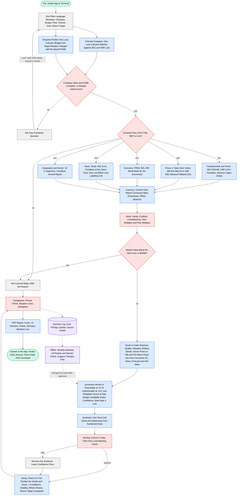

# Architecture

Two diagrams of the agent as built (scorecard version 6, 10 October 2026). The overview
shows the path a question takes; the full diagram shows every source, check and rule.
The Mermaid sources, with notes on every change, are kept with the design documents.

## Overview

Colours: green is the start and the end, red a check or guardrail, grey a question back
to you or a routing step, blue retrieval or processing, purple storage and offline
evaluation.

## Full architecture

Solid lines are data, dotted lines are caches, logs and monitoring. Nodes with a dashed
border are planned but not built (the India price fallback, MoSPI, GDELT, skipping
optional data under time pressure).

```mermaid
flowchart TD

    subgraph UI["Interface"]
        APP["Gradio App on This Computer Only: Chat, Live Progress List, Result Card with Score Bars, Five-Year Price Chart, PDF Download; Tabs for Profile, Run Details, Track Record"]
        CLI["Terminal: main.py, --detail for the Developer View"]
        RT["run_turn: One Graph Run per Message, Carries Answers Into the Next Message When a Turn Ends With a Question"]
        APP --> RT
        CLI --> RT
    end

    subgraph INPUT["Input Layer"]
        A["Raw Message: Company, Profile, Budget and Return Target May All Be in One Message"]
        B["Entity Resolution: One Luna Call Extracts the Company and Suggests a Full Name; Matcher Against SEC and NSE Lists, Score 90+ and a 10-Point Lead; Asks When Unclear, When Names Disagree, or When Cross-Listed"]
        B2["Profile Intake: One Luna Call plus Plain-Code Readers for Budget (2 lakhs, 1.5 crore, $5,000) and Return Target; Merged with the Saved Profile"]
        A --> B
        A --> B2
        B --> BX{"Covered? Not a 20-F Filer, REIT or InvIT"}
        IG{"Input Gate: Company Resolved and Required Profile Fields Present, or Already Asked Once?"}
        B --> IG
        B2 --> IG
        IG -->|"No"| ASK["Ask Once: Which Listing, and Missing Fields in One Combined Question"]
        BX -->|"No"| NC["Not Covered Reply with the Reason"]
    end

    subgraph RETRIEVAL["Data Retrieval Layer - Five Agents in Parallel, MCP Servers Kept Open for the Request"]
        D1["Fundamentals Agent, Plain Code: Operating Income and Depreciation Rebuilt From Their Parts When Not Reported; US Share Count Fallbacks"]
        D2["Technical and Price Agent, Plain Code: 5 Years of Prices, Volatility, Beta, Drawdown, Index Comparison"]
        D3["Macro Agent, Plain Code: Fixed Panel of Six Economies, Regime Labels"]
        D4["News Agent: Sources Asked at the Same Time; at Most 15 Items, One Low-Effort Luna Labelling Call; Labels Saved 7 Days"]
        D5["Geography and Sector Agent, Plain Code"]

        D1 -->|"US"| D1a[("SEC EDGAR Company Facts, Tier 1")]
        D1a -->|"fallback"| D1b[("FMP Free Plan, Tier 2")]
        D1 -->|"India"| D1c[("Trendlyne MCP Pro: 6 Years, 3 Calls a Company, Tier 2")]
        D1 -->|"India capex"| D1d[("yfinance Cash Flow, Tier 2")]
        D1 -->|"peers US"| D1p[("FMP Peer List plus SEC Frames")]
        D1 -->|"peers India"| D1q[("Trendlyne Industry Peers, Widened to the Sector Below 8")]
        D2 --> D2a[("Yahoo Finance, Stock and Index, Tier 2")]
        D2a -->|"fallback, US"| D2b[("Massive Free Plan, 2 Years, Tier 2")]
        D2a -.->|"fallback, India"| D2c[("Trendlyne Prices: Not Built, Not Needed So Far")]
        D3 --> D3a[("FRED (US), Tier 1")]
        D3 --> D3c[("BIS Policy Rates, IMF Growth and Inflation, World Bank Fallback, Tier 1")]
        D3 -.-> D3b[("MoSPI: Not Needed (A6)")]
        D4 --> D4a[("Tavily, Trusted Outlets, Tier 3")]
        D4 -->|"US"| D4c[("SEC 8-K Filings, Tier 1")]
        D4 -->|"India"| D4d[("Trendlyne News and Insider Trades, Last Month, Tier 2")]
        D4 -.-> D4e[("GDELT: Unreachable (A7), Skipped 12 Hours After 2 Failures")]
        D5 -->|"US"| D5a[("10-K Segments via edgartools, Tier 1")]
        D5 -->|"India"| D5b[("Trendlyne Annual Report Table, Tier 2")]
        D5 --> D5c[("Sector: SEC SIC Codes, Yahoo")]
    end

    subgraph FXN["Currency"]
        FX1["FX Step, Plain Code: Converts Only Where Currencies Meet; Currency Risk Note"]
        FX1 --> FXa[("Frankfurter: FBIL if Fresh, Else Official Blend, Tier 1")]
        FXa -->|"cross-check, fallback"| FXb[("FRED DEXINUS, Tier 1")]
        FXb -->|"last resort"| FXc[("yfinance USDINR, Tier 2")]
    end

    subgraph VERIFY["Verification Layer, Plain Code"]
        E["Sanity Checks, Cross-Source Conflicts, Tiered Completeness, Bank Mode"]
        E --> ESC{"Market Value Below Rs 500 Crore or $300M?"}
        ESC -->|"No"| E5["Own Multiples and Peer Medians: 5 Peers, or 3 to 4 Marked Few; Loss-Makers and Small Peers Left Out; Weak-Peer Flag Above 100% Dearer"]
        E --> EW["Completeness Below 70% or a Critical Gap: Amount Withheld, Analysis Continues"]
    end

    subgraph ANALYSIS["Analysis Layer, Plain Code"]
        F1["Business Quality: Growth of Usual Years, ROIC or ROE, Margin Trend, Balance Sheet, Cash Generation"]
        F1v["Valuation: P/E and EV/EBITDA Against Peers, Large-Company Bands, Scores Slide Between Bands; P/B and P/S When Too Few Peers Are Profitable; Sector Peers or 3 to 4 Peers Count as Low Reliability"]
        F2["Economic Fit: Regimes x Sector Sensitivity, Weighted by Revenue by Economy, Currency Rule"]
        F3["News: Net Sentiment, Halved for Thin Coverage"]
        F4["Projection and Fair Value: Base Growth from Last 3 Usual Years, Capped at 25% with the Range Kept Open; Year 1 at Peer Forward P/E and EV/EBITDA; None When the Latest Year Is Unusual or Peers Are Weak"]
        GS["Scorecard Version 6: Weights 50/20/15/5/10, Favourable at +0.75, Unfavourable at -0.5; Low-Reliability Scores at Half Weight; Overrides, Suitability Rules; Confidence High Only With 4 of 5 Sub-Scores; Note Within 0.1 of a Line"]
        F1 --> GS
        F1v --> GS
        F2 --> GS
        F3 --> GS
        F4 --> GS
    end

    subgraph SYN["Synthesis and Guardrail"]
        G["Synthesis: One Terra Call Over Numbered Facts; May Move the Verdict One Step With a Cited Reason"]
        H1["Grounding Check 1, Code: Every Number Must Appear in the Facts It Cites"]
        H2["Grounding Check 2: One Low-Effort Luna Meaning Check"]
        H3["Remove Failing Sentences, Lower Confidence Once, Templated Reasoning After Three Removals"]
        G --> H1 --> H2 --> H3
    end

    subgraph DECISION["Decision Layer, Plain Code"]
        I1["Sizing Version 2: Full Position = Concentration Limit; Favourable 60-100%, Neutral 30-60% by Score, x Confidence 1.0/0.9/0.8, Volatility Scaling, Whole Shares, Currency"]
        I2["Notes: Full Position, How Much More Would Fit, Fractional Shares, 5-Year Growth Against the Index, Return Target Against Fair Value"]
        I1 --> I2
    end

    subgraph OUT["Compliance and Report"]
        J["Compliance: Banned-Phrase Check, Situation Lines, Short and Full Disclaimer; No Disclaimer, No Answer"]
        RA["PDF Report, ReportLab: Cover, 13 Sections, Scorecard Explained, Glossary, Charts, Backtest Line; Integrity Checks"]
        K["Answer: Compact Text in Chat or Terminal, Result Card, PDF"]
        J --> RA --> K
    end

    subgraph STORE["SQLite: Caches, Profile, Logs"]
        CACHE[("One Cache Table: Fundamentals 24h, Prices, Macro 24h, FX 24h, Peers 24h, Segments 7d, News 1h, News Labels 7d, Source Health")]
        N[("Saved Profile: Stated Fields Only")]
        O[("Decision Log, 2 Years: Inputs, Records, Scores, Facts, Reasoning, Guardrail, Sizing, Answer, Cost, Timings, Year-1 Projections, Report Path")]
    end

    subgraph OBS["Observability, Cross-Cutting (Step 14)"]
        COST["Cost Tracker: Tokens Priced per Model"]
        TIME["Step Timings, Also Feed the App's Progress List"]
        QUOTA["Quota Counts: Tavily, Trendlyne, FMP; Warning at 80%"]
        HM["Source Health Monitor: 3 Failures in 10 Minutes, Down 15 Minutes (IMF 30), Callers Use Their Fallback"]
        SKIP["Skip Optional Enrichment Under Time Pressure: Not Built"]
    end

    subgraph EVAL["Offline Evaluation, Run by Hand (Step 15)"]
        P1["Monthly Backtest: Live Verdicts After 12 Months Against the Benchmark; Year-1 Projections Against Reported Figures; Calibration Check"]
        P2["US Replay of Past Dates: SEC Figures as Filed, Prices Cut at the Date, 50 Largest of About 100 on Each of 4 Dates; What Predicted What, Score Bands; Tuning Only if It Works on Held-Out Verdicts"]
        P3["Spread Check: 24 Very Different Companies Through the Live Agent; Where the Verdicts Land and Why"]
    end

    %% Main flow
    RT --> A
    IG -->|"Yes"| BX
    BX -->|"Yes"| D1
    BX -->|"Yes"| D2
    BX -->|"Yes"| D3
    BX -->|"Yes"| D4
    BX -->|"Yes"| D5
    ASK -->|"reply in the next message"| RT
    D1 --> FX1
    D2 --> FX1
    D3 --> FX1
    D4 --> FX1
    D5 --> FX1
    FX1 --> E
    ESC -->|"Yes"| NC
    NC --> J
    E5 --> F1
    E5 --> F1v
    E5 --> F2
    E5 --> F3
    E5 --> F4
    GS --> G
    H3 --> I1
    EW -.->|"amount withheld"| I1
    I2 --> J
    K --> APP
    K --> CLI

    %% Storage, logs and instrumentation
    B2 -.-> N
    RETRIEVAL -.->|"cached"| CACHE
    FXN -.->|"cached"| CACHE
    HM -.-> CACHE
    RT -.->|"each analysis"| O
    RA -.->|"PDF path"| O
    COST -.-> O
    TIME -.-> O
    TIME -.->|"progress"| APP
    RETRIEVAL -.->|"every outside call watched"| HM
    QUOTA -.->|"warnings"| APP
    O --> P1
    P1 -.->|"suggests only, changed by hand"| GS
    P2 -.->|"suggests only, changed by hand"| GS
    P3 -.->|"found gaps, changed by hand"| GS

    classDef notbuilt stroke-dasharray: 5 5,stroke:#999999,color:#777777;
    class D2c,D3b,D4e,SKIP notbuilt;
```

## The layers in words

**Interface.** A Gradio app on your own computer and a terminal command, both calling the
same `run_turn`. When a turn ends with a question, the answers so far are carried into
the next message.

**Input.** Two steps read the same message at the same time: one finds the company (one
Luna call, then a matcher on the SEC and NSE company lists), the other reads the profile
(one Luna call plus plain-code readers for amounts like "2 lakhs" and targets like "10% in
2 years"). A gate asks one combined question if anything is missing or unclear, and a
coverage check turns away companies the agent does not handle (foreign filers, REITs and
InvITs, very small companies).

**Retrieval.** Five agents run at the same time, each through an MCP server:
- **Fundamentals and peers:** SEC EDGAR and FMP (US), Trendlyne and yfinance (India).
- **Prices:** Yahoo, with Massive as the US fallback.
- **Economy:** FRED, BIS, IMF and the World Bank, for six economies.
- **News:** Tavily, SEC 8-Ks and Trendlyne disclosures, with one low-effort Luna call to
  label them.
- **Revenue by country and sector:** 10-K segments, and Trendlyne's annual report table.

**Currency.** Converts only where currencies meet (a rupee budget for a dollar stock),
using official rates, with a FRED cross-check and a note on how the currency has moved.

**Verification.** Sanity checks, conflicts between sources, a tiered completeness score
that can withhold the amount, the company's own multiples, and peer medians after the
peers are filtered.

**Analysis.** Five sub-scores in plain code, a projection of next year with a fair value
range, and the scorecard: fixed weights, verdict lines, low-reliability rules, overrides,
suitability rules and confidence.

**Synthesis and guardrail.** One Terra call writes the reasoning from numbered facts.
Every number is then checked against the facts it cites, and one Luna call checks each is
used with the right meaning.

**Decision, compliance and report.**
- **Sizing:** the amount, as a share of a full position.
- **Compliance:** the disclaimer and a banned-phrase check.
- **Report:** the PDF, drawn with ReportLab.

**Around everything:**
- **Caches:** one SQLite table holds them all.
- **Saved profile.**
- **Decision log:** kept for two years.
- **Tracking:** cost, step timings, free-plan usage and a source health monitor.

**Offline:**
- **Monthly backtest:** scores live verdicts after 12 months.
- **US replay:** rebuilds past dates.
- **Spread check:** runs 24 different companies through the live agent.

They only suggest changes; a change to the scorecard is made by hand, with a new version
number. See [findings.md](findings.md).
